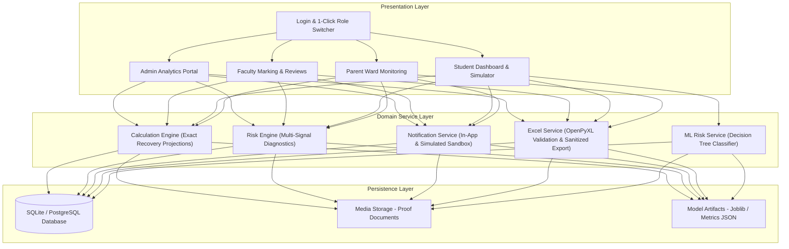

# Student Attendance Intelligence & Early Warning System

> **A modern educational technology platform featuring period-wise attendance recording, explainable multi-signal risk classification, mathematical recovery simulation, immediate multi-channel parent alerts, and institutional analytics.**

Part of the **90 Days – 90 Projects Challenge (Day 5)** by **Ragu Ram P**, Final-Year B.Tech in Artificial Intelligence & Data Science.

[](https://www.python.org/)
[](https://www.djangoproject.com/)
[](tests/)
[](LICENSE)
[]()

---

## 1. Problem Statement & Motivation

Across colleges and universities, student absenteeism is frequently discovered too late. Traditional attendance management systems suffer from critical flaws:

1. **Course Coarseness:** Treating whole days as present or absent fails to represent period-by-period university schedules where missing one hour should not mark a student absent for the entire day.
2. **Late Interventions:** Students only discover eligibility debarment risks during exam registration week when recovery is mathematically impossible.
3. **Parental Disconnect:** Parents receive absence reports weeks after consecutive cuts have accumulated.
4. **Dispute Inefficiencies:** Correction of roll-call discrepancies and sanctioned On-Duty (OD) participation (hackathons, symposiums, medical leave) requires physical paper trails and lost approvals.

The **Student Attendance Intelligence & Early Warning System** bridges this gap through real period-by-period tracking, mathematically proven recovery projections, explainable risk rules, automated parent notifications, and digital approval workflows.

---

## 2. Key Features

### 🏛️ Multi-Role Educational Portals
- **Administrator Portal:** Executive analytics dashboard, departmental comparisons, student/faculty directories, policy threshold configuration, Excel import/export, and system audit logs.
- **Faculty Portal:** Timetable view, period-by-period attendance recording with bulk toggle shortcuts, audited session history edits with mandatory reasons, at-risk student monitoring, and leave/dispute approval queues.
- **Student Portal:** Subject-wise breakdown, attended vs. eligible session counts, mathematical recovery projections, interactive What-If Recovery Simulator, leave/OD submissions, and dispute filings.
- **Parent Portal:** Real-time visibility into linked children's attendance, recent absence records, parental absence explanation submission, and notification channel preference controls.

### 📐 Accurate Calculation Engine & Recovery Mathematics
- Computes period-weighted percentages: $(\text{Attended} / \text{Eligible}) \times 100$.
- Safely handles edge cases (zero eligible sessions, 100% target after absences, exact threshold matches).
- **Minimum Consecutive Sessions Needed to Recover ($S$):**
  $$S = \max\left(0, \left\lceil \frac{T \cdot N - P}{1 - T} \right\rceil\right)$$
  *(where $T$ is target decimal, $P$ is present sessions, and $N$ is total held sessions)*.
- **Maximum Permissible Further Absences ($M$):**
  $$M = \max\left(0, \left\lfloor \frac{P - T \cdot N}{T} \right\rfloor\right)$$

### ⚠️ Explainable Risk Classification & Early Warning
- Transparent rule-based classification into **Safe ($\ge 80\%$)**, **Warning ($75\% - 80\%$)**, and **Critical ($< 75\%$)**.
- Multi-signal diagnostics: distance from threshold, consecutive absence runs, 14-day absence velocity, and recovery feasibility.
- Optional scikit-learn **Decision Tree Classifier** extension trained on stratified features with confusion matrix evaluation and seamless rule-engine fallback.

### 🔔 Immediate Parent Notifications & Delivery Abstraction
- Alerts linked parents immediately upon an unexcused period absence.
- Prevents duplicate alerts using database idempotency markers.
- Multi-channel delivery abstraction: In-App notifications, Console/SMTP Email, and clearly identified simulated SMS/WhatsApp sandbox modes.

### 📊 Excel Batch Import & Injection-Sanitized Export
- Validates uploaded `.xlsx` spreadsheets row-by-row with preview reporting.
- Checks roll numbers, subject codes, date formats, and duplicate records.
- Sanitizes formula injection attacks by escaping leading control characters (`=, +, -, @`).

---

## 3. Visual Design System

Inspired by modern editorial platforms and premium institutional software, the platform rejects harsh dark developer dashboards in favor of a warm, human-centered design:

- **Main Background:** Warm Ivory (`#F7F5EF`)
- **Primary Brand:** Forest Green (`#24483D`)
- **Secondary Accent:** Sage (`#A8B8A0`)
- **Action Highlight:** Burnt Terracotta (`#C66A4A`)
- **Accent Gold:** Muted Gold (`#C5A45D`)
- **Main Text:** Charcoal (`#292D2A`)
- **Borders & Dividers:** Warm Grey (`#E4E0D6`)
- **Status Badges:** Deep Green (`#397653`), Amber (`#B7791F`), Muted Brick Red (`#B54743`) with explicit non-color text labels and icons.

---

## 4. System Architecture



---

## 5. Technology Stack

- **Backend:** Python 3.12, Django 5.1 (Django ORM, Authentication, Session Security)
- **Frontend:** Django Templates, Semantic HTML5, CSS3 Custom Tokens, JavaScript, Chart.js 4.4
- **Database:** SQLite (default for development; compatible with PostgreSQL)
- **Data Processing & Sheets:** OpenPyXL 3.1, Pandas 3.0, ReportLab 5.0
- **Machine Learning:** Scikit-learn 1.9 (Decision Tree Classifier, Evaluation Metrics)
- **Testing:** Django Test Runner & Pytest (25 automated test cases)

---

## 6. Directory Structure

```text
90-days-90-projects-day-05-student-attendance-intelligence/
├── README.md                           # Main recruiter-ready documentation
├── QUICKSTART.md                       # Rapid 2-minute setup guide
├── DEMO_SCRIPT.md                      # 90-second interview demonstration sequence
├── LICENSE                             # MIT License
├── requirements.txt                    # Pinned Python package dependencies
├── pyproject.toml                      # Build system & pytest configuration
├── .env.example                        # Environment variables template
├── .gitignore                          # Git exclusion rules
├── setup.bat                           # 1-click Windows setup & dependency script
├── run.bat                             # 1-click development server launcher
├── test.bat                            # 1-click automated test suite runner
├── core/                               # Django project configuration (settings, urls, wsgi)
├── attendance/                         # Core domain application
│   ├── models.py                       # 22 normalized database models
│   ├── context_processors.py           # Global role, notification, and badge context
│   ├── services/                       # Centralized business logic
│   │   ├── calculation_engine.py       # Attendance %, recovery formulas, simulator
│   │   ├── risk_engine.py              # Rule-based classification, absence velocity
│   │   ├── notification_service.py     # De-duplicated alerts & delivery tracking
│   │   ├── excel_service.py            # OpenPyXL validator & formula-safe exports
│   │   └── ml_risk_service.py          # Decision Tree model & evaluation
│   ├── views/                          # Modular role controllers
│   │   ├── auth_views.py               # Sign-in, sign-out, profile, 403/404 handlers
│   │   ├── admin_views.py              # Executive analytics, master data, policies
│   │   ├── faculty_views.py            # Period marking, session history, dispute reviews
│   │   ├── student_views.py            # Dashboard, what-if simulator, leaves, disputes
│   │   ├── parent_views.py             # Linked wards, absence log, explanations
│   │   ├── notification_views.py       # Notification center, mark-as-read
│   │   └── api_views.py                # Real-time AJAX simulation endpoints
│   ├── templates/                      # Clean, warm ivory HTML templates
│   ├── static/                         # CSS design tokens, custom JS, Chart.js helpers
│   └── management/commands/
│       ├── seed_demo_data.py           # Realistic multi-role demonstration dataset
│       └── train_risk_model.py         # Decision tree training & metrics evaluator
├── tests/                              # Comprehensive test suite (25 automated tests)
├── docs/                               # Deep architectural & technical notes
│   ├── PROJECT_OVERVIEW.md
│   ├── ARCHITECTURE.md
│   ├── USER_GUIDE.md
│   ├── DEVELOPMENT_NOTES.md
│   ├── TESTING.md
│   └── TROUBLESHOOTING.md
├── data/                               # Sample templates & dataset documentation
│   ├── README.md
│   └── sample_attendance_template.xlsx
└── screenshots/                        # Interface preview captures
```

---

## 7. Windows Installation & Setup

### Prerequisites
- Windows 10 or 11 (64-bit)
- Python 3.10, 3.11, or 3.12 (`py --version` or `python --version`)
- Git for Windows (`git --version`)

### Quick Setup via Batch Scripts
1. Open PowerShell or Command Prompt in the project folder.
2. Run `setup.bat`:
   ```cmd
   setup.bat
   ```
3. Once completed, start the application:
   ```cmd
   run.bat
   ```
4. Open your browser at **[http://127.0.0.1:8000/](http://127.0.0.1:8000/)**.

---

## 8. Demo User Accounts

The login screen provides **1-click quick-fill buttons** for each role:

| Role | Username | Password | Profile Highlights |
| :--- | :--- | :--- | :--- |
| **Institutional Admin** | `admin` | `admin123` | Institutional command center, policies, logs |
| **Faculty Member** | `prof_ananya` | `faculty123` | Teaches AI701 & AI702; marks periods, approves leaves |
| **Student (Safe)** | `23ai001` | `student123` | Aarav Sharma (92% attendance, Safe) |
| **Student (Warning)** | `23ai008` | `student123` | Diya Mehta (77% attendance, Warning buffer) |
| **Student (Critical)**| `23ai014` | `student123` | Rohan Verma (68% attendance, Critical risk) |
| **Parent** | `parent_sharma` | `parent123` | Mr. Rajesh Sharma (Linked to 23AI001) |

---

## 9. Automated Testing & Verification

Execute the test suite using `test.bat`:

```cmd
test.bat
```

### Actual Test Results
```text
Creating test database for alias 'default'...
Found 25 test(s).
System check identified no issues (0 silenced).
.........................
----------------------------------------------------------------------
Ran 25 tests in 36.375s

OK
Destroying test database for alias 'default'...
=====================================================================
 ALL TESTS PASSED SUCCESSFULLY!
=====================================================================
```

Coverage spans authentication, role permissions, zero-session edge cases, mathematical recovery formulas, margin-of-absence calculations, parent notification triggers, dispute workflows, and Excel formula injection protection.

---

## 10. Security & Privacy Considerations

- **Server-Side Enforcement:** Every route enforces permission decorators (`@role_required`). Client-side element hiding is never used as the sole protection.
- **Parent-Child Isolation:** Parents can access only children explicitly verified through `StudentParentRelation` records.
- **Audited Edits:** Modifying finalized attendance sessions requires a mandatory justification recorded in `AuditLog`.
- **Injection Defense:** Spreadsheet exports neutralize leading `=, +, -, @` characters to protect administrators against spreadsheet formula injection attacks.

---


---

## 11. License & Attribution

Distributed under the **MIT License**. Created by **Ragu Ram P** for the **90 Days – 90 Projects Challenge**.
