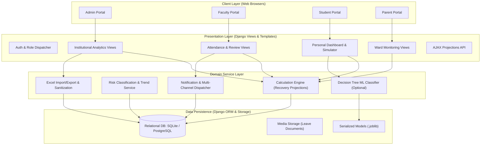

# System Architecture & Technical Specifications

This document outlines the architectural patterns, data flow models, database schema, and security layers of the **Student Attendance Intelligence & Early Warning System**.

---

## 1. High-Level System Architecture

The application adopts a **Layered Domain-Service Architecture** on top of the Django framework, strictly separating presentation controllers, business domain services, and database persistence layers.

---

## 2. Core Service Boundaries

### A. Calculation Engine (`attendance/services/calculation_engine.py`)
- **Zero Divisor Protection:** Returns 100.0% standing when no class sessions have been recorded.
- **Period Attendance Formula:**
  $$\text{Attendance Percentage} = \min\left(100.0, \frac{\text{Present} + \text{Excused}}{\text{Total Eligible}} \times 100\right)$$
- **Recovery Requirement Formula:**
  For target percentage $T \in (0, 1)$, present sessions $P$, and total eligible sessions $N$:
  $$\text{Sessions Needed} = \max\left(0, \left\lceil \frac{T \cdot N - P}{1 - T} \right\rceil\right)$$
- **Margin of Absence Formula:**
  $$\text{Max Permissible Absences} = \max\left(0, \left\lfloor \frac{P - T \cdot N}{T} \right\rfloor\right)$$

### B. Risk & Early Warning Engine (`attendance/services/risk_engine.py`)
- **Deterministic Rules:** Evaluates percentage boundaries against institutional policy (Default: $\ge 80\%$ Safe, $75\%-80\%$ Warning, $<75\%$ Critical).
- **Consecutive Absences Detection:** Escalates student standing to Warning or Critical upon detecting 3 or more consecutive unexcused session absences.
- **Velocity Analysis:** Tracks 14-day absence rate to flag negative trajectories before thresholds are breached.

### C. Notification Engine (`attendance/services/notification_service.py`)
- Dispatches database-backed alerts to linked parent accounts upon single period absences.
- De-duplicates alerts using session-record idempotency markers (`absence-rec-{id}`).
- Records delivery attempts across In-App, Console Email, Simulated SMS, and Simulated WhatsApp channels.

### D. Excel Service (`attendance/services/excel_service.py`)
- Employs `openpyxl` to parse, validate, and preview spreadsheets before committing changes.
- Row-level validation checks: roll number existence, subject enrollment, date format, and duplicate file entries.
- Sanitizes leading control characters (`=, +, -, @`) in exported files to eliminate spreadsheet formula execution risks.

---

## 3. Database Entity Relationship Model

```mermaid
erDiagram
    Department ||--o{ ClassSection : contains
    AcademicYear ||--o{ Semester : contains
    Semester ||--o{ ClassSection : organizes
    Department ||--o{ Subject : offers
    Semester ||--o{ Subject : schedules
    ClassSection ||--o{ StudentProfile : enrolls
    StudentProfile ||--o{ StudentParentRelation : links
    ParentProfile ||--o{ StudentParentRelation : guardians
    FacultyProfile ||--o{ FacultySubjectAssignment : teaches
    Subject ||--o{ FacultySubjectAssignment : assigned_to
    ClassSection ||--o{ FacultySubjectAssignment : taught_in
    ClassSection ||--o{ TimetableSession : schedules
    Subject ||--o{ TimetableSession : allocated_in
    ClassSection ||--o{ AttendanceSession : conducted_in
    Subject ||--o{ AttendanceSession : covers
    AttendanceSession ||--o{ AttendanceRecord : records
    StudentProfile ||--o{ AttendanceRecord : marked_for
    AttendanceRecord ||--o{ AttendanceCorrectionRequest : disputes
    StudentProfile ||--o{ LeaveRequest : submits
    StudentProfile ||--o{ Notification : pertains_to
    Notification ||--o{ NotificationDeliveryAttempt : attempts
```

---

## 4. Security Architecture

1. **Server-Side Authorization:** Every protected view is wrapped with role-enforcing decorators (`@admin_required`, `@faculty_required`, `@student_required`, `@parent_required`).
2. **Access Control Isolation:**
   - Students cannot view or simulate attendance for peers.
   - Parents can query only children linked through authenticated `StudentParentRelation` records.
   - Faculty can mark attendance and review requests solely for their allocated courses and class sections.
3. **Data Integrity:**
   - Multi-step attendance marking and batch Excel commits execute within atomic database transactions (`transaction.atomic()`).
   - All session modifications require mandatory human explanations recorded in `AuditLog`.
